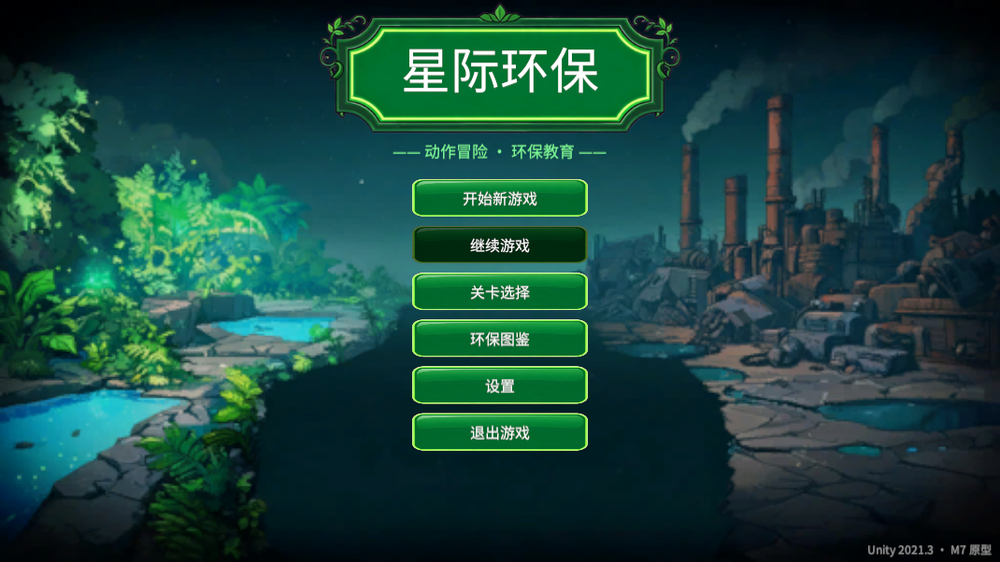
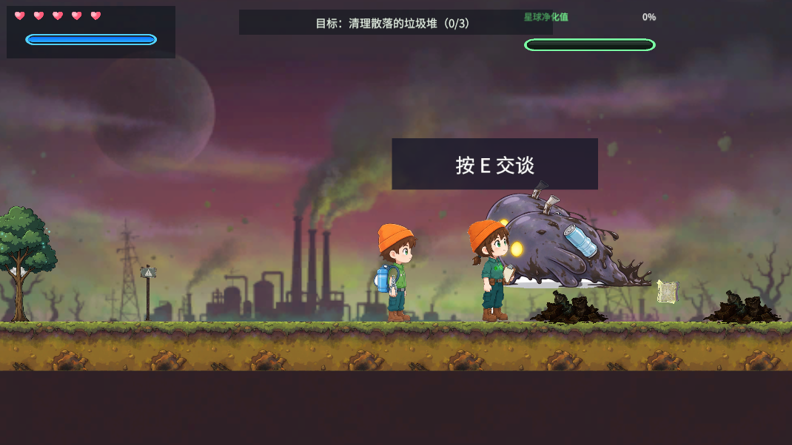
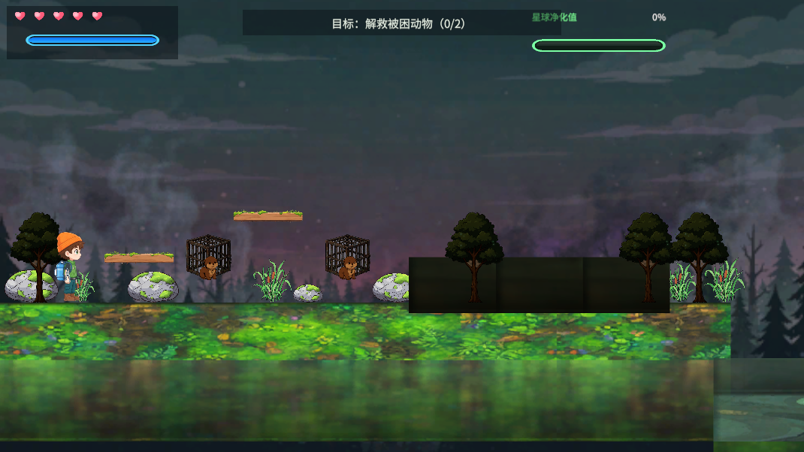
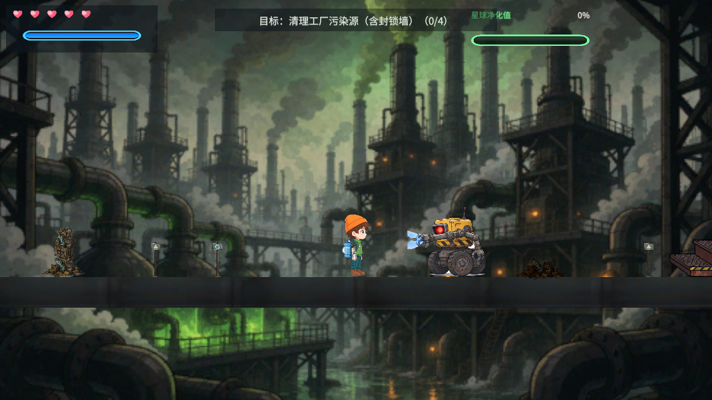

<div align="center">

# 星际环保 · StarEco

**基于 Unity 2D 的环保主题动作冒险游戏 · 全流程 AI 协同开发实践**

[](https://unity.com)
[](https://learn.microsoft.com/dotnet/csharp/)
[](https://github.com/topics/ai-assisted-development)
[](https://www.microsoft.com/windows)
[](LICENSE)

一款把「环境保护」做成可玩机制的 2D 动作游戏 —— 由 **AI 编程助手 + 生成式图像模型** 协同完成，
从零构建到 **2.4 万行代码 / 421 张逐帧动画 / 3 个完整关卡**。

**本仓库同时是一份 AI 协同开发的技术实践记录** —— 完整展示如何把 AI 变成可控、可验证、
可交付的产能，而不是只让它生成孤立代码片段。

[⬇️ 下载 Windows 版](#-下载) · [🤖 AI 协同开发工作流](#-ai-协同开发工作流) · [🧩 技术架构](#-技术架构) · [📊 开发数据](#-开发数据)

> 📖 **想看完整的 AI 协同方法论？** 看 [Docs/AI-工作流.md](Docs/AI-工作流.md) ——
> 包含提示词工程实践、管线设计原理、MCP 工具链用法、能力边界实测、以及一个完整的排查案例复盘。

</div>

---

## 📸 截图

<div align="center">

### 主菜单



### 第一关 · 污染星球 — 清理散落的垃圾堆



### 第二关 · 生态森林 — 解救被困动物



### 第三关 · 能源工厂 — 清理污染源（含封锁墙）



</div>

---

## 🤖 AI 协同开发工作流

> **这是本项目最想展示的部分。**
> AI 协同的真实难点不是"让 AI 写代码"，而是**如何让 AI 的产出可控、可验证、可交付**。

### 我如何分工

| 工作类型 | 承担方 | 说明 |
|---|---|---|
| 架构设计、技术选型、方案取舍 | **人** | FSM vs ECS、事件驱动解耦、武器与角色分离、零 GC 策略 —— 所有架构决策由人拍板 |
| 需求定义与验收标准 | **人** | 定义"什么叫做对了"，并逐项验收 AI 的产出 |
| 玩法代码实现 | **人 + AI 协同** | AI 生成初稿，人审查、重构、补齐边界情况 |
| 角色 / 场景美术 | **生成式模型 + 程序化管线** | AI 出图，程序化管线做切帧、抠像、归一化，保证一致性 |
| 音效 / BGM | **程序化合成** | `Tools/audio-pipeline/synthesize.py` 全程序化生成 |
| 质量验证 | **人 + 自动化** | 12 项运行时自检、13 个 EditMode 测试、逐页渲染复核 |
| 问题排查与归因 | **人** | 定位根因、验证假设（见下方案例） |

### ① 让 AI 产出「可用」而不是「能编译」

**逐帧精灵表生成**是 AI 最容易翻车的地方 —— 我实测过两次整网格生成，产出 7/8 帧姿态完全相同。
解决方案是拆解任务粒度：

```
统一角色描述串  +  逐帧精确姿态描述  →  逐张生成  →  拼网格  →  过程序化管线
```

配套的自建管线（`Tools/art-pipeline/`，24 个脚本）解决 AI 产出的三大先天缺陷：

| AI 产出的问题 | 管线的解法 | 技术要点 |
|---|---|---|
| 逐帧人物占比不一致（实测比基准大 1.2 倍） | **刚性标尺归一化** | 用「橙色罗纹帽」的像素高做标尺 —— 纯色刚性部件不随姿态形变，可稳定测量 |
| 蹲伏帧画得比站姿帧更满，导致"蹲下反而变高" | 同上 + 高度限幅 | 缩放按帽子归一，并加内容高度上限防止检测漂移 |
| 横向动作（挥臂/冲刺）被画格裁切 | **画格宽度取最宽帧** | 缩放取最高帧、画格宽取最宽帧，两个维度解耦 |
| 白底/黑底/透明底混杂 | **入口背景归一化** | 统一转 RGBA master，后续抠像算法才有稳定前提 |
| 帧间脚底线漂移造成角色跳动 | **基线对齐** | 统一缩放后按脚底线对齐 |
| 帧内碎影噪点 | **连通域清理** | 保留真实白色区域（白 T 恤、眼白），只去碎影 |

**提示词工程**同样重要 —— 提示词库独立成目录（`Tools/art-pipeline/prompts/`），
与脚本分离管理；实测中"手抬到腰线"会被画成"手插裤兜"（无法握持工具），
改写成"手垂身侧、拳在大腿前"并显式禁止插兜/搭腰带/藏腿后才稳定。

### ② 让 AI 的产出「可验证」

这是我认为 AI 协同开发里**最被低估的一环**：AI 给你代码，你必须能判断它对不对。

**自建验证体系**（`Assets/Scripts/Framework/FrameworkSelfTest.cs`，12 项运行时自检）：

```
✓ 对象池预热与取出      ✓ 对象池归还隐藏      ✓ 对象池重复归还防御
✓ 事件总线发布与订阅    ✓ 存档保存与读取      ✓ SaveSystem 损坏容错
✓ …共 12 项，构建版运行时全部 PASS
```

配合 **13 个 EditMode 测试用例**（独立 asmdef 程序集隔离，编辑器代码不泄漏进运行时包）。

**逐页渲染复核** —— 文档类产出（README / 开题报告）必须转成 PDF 再转图逐页看，
XML 检查发现不了"横线丢了""引用被裁切"这类版式问题。这套方法在文档工作里抓出过 3 个 bug。

### ③ 让人与 AI 的协作「有迹可循」

**通过 Unity MCP 让 AI 直接操作编辑器**，而不是只写代码文件：

| 能力 | 用途 |
|---|---|
| `manage_scene` / `manage_gameobject` | 场景搭建、批量创建对象、绑定组件 |
| `manage_script` / `create_script` | 脚本创建与热重载 |
| `manage_build` | 触发构建并轮询任务状态 |
| `execute_code` | 在编辑器上下文执行 C# 片段做即时诊断 |
| `read_console` | 读取编译错误与运行日志 |
| `manage_camera` | 游戏视图截图，用于视觉验证 |
| `run_tests` | 跑测试套件 |

这套通路让 AI 能够**"看到"自己写的东西** —— 编辑器报错能直接读到、画面能直接截到、
构建结果能直接轮询到，而不是靠人转述"报错了/画歪了"。

### ④ 案例：AI 产出引发的真实缺陷，及排查过程

**症状**：第一次 Windows Release 构建产物 **1.6 GB** —— 对一个 2D 动作游戏明显不合理。

完整排查链（每一步都是可验证的假设）：

1. **排除资源本身**：源文件 693 MB，进包纹理仅 240 MB → 膨胀发生在 Unity 导入/打包环节
2. **交叉统计定位**：统计*进包纹理的尺寸对齐性 × 实际格式*，发现 100% 吻合的规律：

   | 尺寸对齐 | 实际格式 | 数量 | 占用 |
   |---|---|---|---|
   | 宽高**都是** 4 的倍数 | DXT1 / DXT5 压缩 | 41 | 30 MB |
   | 任一维度**非** 4 的倍数 | **RGBA32 未压缩（4 字节/像素）** | 395 | **2655 MB** |

3. **根因**：AI 出图管线按内容自适应生成画格，尺寸是 1200×833、993×1124、1397×1247…
   这类**非 4 倍数**。而 Unity 的 Automatic 格式选择器对 NPOT 纹理会
   **放弃 BC/DXT 压缩、退回未压缩 RGBA32** —— 整整 4 倍膨胀
4. **验证可干预性**：显式指定 BC7 → **无效**（Unity 不允许 NPOT 用 BC 格式），回退照旧
5. **判断降分辨率是否安全**：相机 ortho=6.5、1080p 下 1 世界单位 = 83px、帧 PPU=378，
   推出**纹理尺寸恒为实际显示尺寸的 4.5 倍** —— 分辨率严重过剩
6. **解法**：批量设 `maxTextureSize = 512`（仍 > 显示尺寸，属**超采样，画质零损失**）。
   纹理存储 3030 MB → 231 MB，整包 **1.6 GB → 333 MB（-79%）**
7. **验证无副作用**：依赖图 637 → 637 完全一致，1555 个 sprite 全部正常加载，
   55 个 AnimationClip / 46 个 Prefab / 14 个 SpriteRenderer 零 null 引用

> 这个案例说明了 AI 协同的一个现实：**AI 负责高效地产出，而判断"产出是否正确"、
> 定位"问题出在哪一层"始终是人的工作**。没有第 2 步的交叉统计，1.6 GB 会被当成"资源太大"，
> 然后草率地把美术质量砍掉。

### ⑤ AI 能力的边界，我踩过才知道

诚实记录几个**实测确认的能力边界**（都写进了项目文档，避免后来者重蹈）：

| 现象 | 结论 |
|---|---|
| 整网格文生图 | **无法控制每帧姿态**（两次实测均产出 7/8 帧同姿势）→ 必须逐帧生成 |
| 纯侧视 + 大角度躯干倾斜 | **做不出来**（连续 3 次实验，模型全都画成直立站姿）→ 改走图像变形实现 |
| 链式参考图 | 会**"粘住"上一张的姿势** → 要大幅改变身体高度必须换参考图 |
| 头身比目测 | 不可靠（实测两张图 2.45 vs 2.44 其实一致）→ 必须用像素测量 |

---

## 🎮 这是个什么游戏

| 维度 | 说明 |
|---|---|
| **类型** | 2D 横版动作冒险 + 环保教育 |
| **主题** | 污染星球 → 生态森林 → 能源工厂，三关主题递进 |
| **核心循环** | 移动探索 → 发现污染源 → 喷枪净化/战斗清除 → 拾取掉落物与知识卡 → 提升星球净化度 → 解锁下一关 |
| **教育设计** | 8 张环保知识卡（塑料降解、碳足迹、可再生能源…）+ 4 组剧情对话，收集后可随时在「环保图鉴」回看 |
| **玩家动作** | 22 套动作动画（跑跳 / 冲刺 / 闪避 / 蹲伏 / 攀墙 / 三段连击 / 投掷武器 / 壁跳 / 边缘抓取） |

**三关的压力递增**不是简单堆血量，而是靠敌人类型制造不同的施压节奏：

| 关卡 | 敌人构成 | 施压特征 |
|---|---|---|
| 一 · 污染星球 | 近战杂兵 | 贴脸施压，教学为主 |
| 二 · 生态森林 | + 远程 / 跳跃单位 | 点射与突袭，需要走位 |
| 三 · 能源工厂 | + 静态防御塔 + 多阶段 Boss | 固定威胁锚点 + 阶段推进 |

---

## ⬇️ 下载

**Windows x64 独立运行版**（无需安装 Unity，解压即玩）

| | |
|---|---|
| 📦 版本 | v1.0 |
| 📏 体积 | 约 330 MB（zip 压缩后约 98 MB） |
| 🖥 要求 | Windows 10 / 11 64 位 |
| 💾 下载 | [⬇️ 直接下载 StarEco-v1.0-win64.zip](https://github.com/wxs-games/star-eco-adventure/releases/download/v1.0/StarEco-v1.0-win64.zip) |

> 解压后请运行 `StarEco.exe`。**必须保留整个目录结构** —— `StarEco.exe` 与 `StarEco_Data/` 是配套的，
> 只拷 exe 无法运行（Unity 标准结构）。

---

## 🎮 操作说明

| 按键 | 功能 | 按键 | 功能 |
|---|---|---|---|
| `A` / `D` 或 `←` / `→` | 左右移动 | `J` / 鼠标左键 | 攻击（三段连击） |
| `W` / `↑` | 跳跃 | `K` | 喷枪净化（持续按住） |
| `S` / `↓` | 下蹲 / 下坠 | `L` | 蓄力（长按强化） |
| `Left Ctrl` | 冲刺 | `E` | 交互 / 对话 |
| `Left Shift` | 闪避 | `Esc` | 暂停菜单 |

---

## 🧩 技术架构

### 分层结构

代码按**十层模块**组织，玩法层与底层设施解耦：

```
Assets/Scripts/
├── Framework/     底层设施：存档、对象池、事件总线、音频管理、运行时自检
├── Core/          全局单例与游戏流程
├── Player/        玩家状态机、移动、动画驱动、武器锚点
├── Combat/        战斗：攻击状态、命中盒、投射物、伤害结算
├── EnemyAI/       敌人状态机、感知、三种敌人实现、防御塔
├── Eco/           环保玩法：净化系统、垃圾堆、破坏物、拾取物、知识卡
├── Boss/          Boss 战：状态、阶段切换、配置
├── Level/         关卡：管理、出生/重生、结算
├── UI/            界面：HUD、各类面板、知识图鉴、对话、伤害数字
└── Editor/        编辑器工具：场景自动搭建、批量构建、运行时诊断修复
```

### 关键设计

**① 有限状态机（FSM）驱动的角色行为**
玩家 11 个状态、敌人独立一套状态机、Boss 独立一套。以 `System.Type` 为键维护状态实例表，
`SwitchState<T>()` 完成切换 —— 状态转移在**编译期**即可校验，避免字符串标识的重构风险。
打断优先级：`Die > Hurt > Attack/Interact > Dash > Jump > Run/Idle`。

**② 角色与武器解耦**
角色动画帧只画空手，武器作为 `ToolAnchor` 子物体外挂：pivot 设在握持点，
`m_LocalPosition` 曲线在**同一个动画片段内**逐帧驱动手部轨迹，`m_IsActive` 曲线控制显隐。
**一套角色动画支持两把不同钳子**，无需重画美术帧。

**③ 事件驱动的零 GC 通信**
跨模块通知全部使用 `struct` 类型事件（`EnemyDamagedEvent`、`GarbagePurifiedEvent`、
`LevelPurifiedEvent`、`BossPhaseChangedEvent` 等），派发过程不产生堆分配。
配合对象池（`ObjectPool<T>` + `PoolManager`，含重复归还防御）与静态数组复用，
**Build 版本运行时 GC alloc = 0**。

**④ 配置驱动的数值系统**
玩家、战斗、敌人、环保、Boss、关卡参数全部收敛到 `ScriptableObject`：
`PlayerConfig` / `CombatConfig` / `EnemyConfig` / `EcoConfig` / `BossConfig` / `LevelConfig`。
调整数值不碰代码。

**⑤ 高精度命中判定**
近战使用动画事件窗口开合判定；**高速投掷物不走物理碰撞**，改为逐帧 `CircleCastNonAlloc`
沿路径扫掠，避免高速穿透。出程飞满射程 / 撞墙 / 超时折返，回程朝武器锚点归位。

---

## 📊 开发数据

| 指标 | 数值 |
|---|---|
| 代码 | **169** 个 C# 文件 / **24,479** 行 |
| 动画 | **54** 个 AnimationClip / **421** 张逐帧素材 |
| 场景 | 4 个（主菜单 + 3 关） |
| 预制体 | 13 个 |
| 编辑器工具 | 47 个脚本（场景自动搭建、批量构建、运行时诊断修复） |
| AI 工具链 | 美术管线 **24** 个脚本 + 音频合成管线 + 提示词库 |
| 测试 | 13 个 EditMode 用例 + 12 项运行时自检（独立 asmdef 程序集隔离） |
| 提交 | 72 次 |
| 构建体积 | 333 MB（Windows x64 Release），较初版优化 **-79%** |

**模块行数分布**

| 模块 | 文件 | 行数 | 模块 | 文件 | 行数 |
|---|---|---|---|---|---|
| Editor | 47 | 7,191 | Player | 7 | 2,400 |
| UI | 18 | 4,264 | Eco | 26 | 2,147 |
| Level | 23 | 2,352 | Boss | 9 | 1,865 |
| EnemyAI | 17 | 1,713 | Combat | 11 | 1,258 |
| Framework | 8 | 908 | Core | 3 | 381 |

---

## 🛠️ 从源码构建

**环境要求**：Unity 2022.3 LTS

```bash
# 1. 用 Unity Hub 打开本工程（选择 Unity 2022.3.x 版本）
# 2. 首次打开会自动导入资源
# 3. 打开 Assets/Scenes/Title.unity
# 4. 菜单 File → Build Settings → Build
```

**场景定序**（`LevelIndex == buildIndex` 是本项目的定序不变式）：

```
Title(0) → Level01(1) → Level02(2) → Level03(3)
```

**目录约定**

| 目录 | 说明 |
|---|---|
| `Assets/Scripts/` | 全部游戏代码（按模块分层） |
| `Assets/Art/` | 角色 / 敌人 / Boss / 场景 / UI 美术资源 |
| `Assets/Animations/` | 动画片段 |
| `Assets/Resources/Data/` | 环保知识卡、对话等 JSON 数据 |
| `Tools/art-pipeline/` | **AI 美术资源生成与处理管线**（24 脚本 + 操作手册 + 提示词库） |
| `Tools/audio-pipeline/` | 程序化音频合成管线 |
| `Tools/balance-kit/` | 数值平衡工具包 |

**AI 工具链的使用方式**详见 [`Tools/art-pipeline/美术资源生成流程.md`](Tools/art-pipeline/美术资源生成流程.md) ——
该文档同时包含面向 AI 的执行指令与面向人的操作手册。

完整的 AI 协同方法论见 **[Docs/AI-工作流.md](Docs/AI-工作流.md)**。

---

## 📝 更新日志

| 版本 | 日期 | 内容 |
|---|---|---|
| v1.0 | 2026-10 | 首个公开版本：三关完整流程、22 套玩家动作、四类敌人 + 多阶段 Boss、8 张环保知识卡、存档与图鉴系统、构建体积优化至 333 MB |

---

## 👤 作者

**张文豪** · 数字媒体技术

**擅长领域**：AI 协同开发（AI 编程助手 + 生成式图像模型的工程化集成）、
Unity 2D 游戏工程、程序化美术 / 音频管线、自动化验证体系搭建。

本项目从零独立完成：架构设计、玩法实现、AI 工具链建设、美术管线开发、
验证体系搭建、构建优化与发布。

**技术栈**：Unity 2022.3 LTS · C# 9.0 · 有限状态机 · 事件驱动架构 ·
ScriptableObject 配置驱动 · 对象池与零 GC 优化 · 2D 精灵动画与 Animation Event ·
生成式图像模型 + 程序化后处理管线 · 程序化音频合成 · Unity MCP 工具集成 ·
自动化测试与自检 · Git 版本管理

---

## 📄 许可证

本项目源码采用 [MIT License](LICENSE) 许可。

美术资源由生成式模型产出并经自建管线后处理，随源码一同授权。
第三方字体资源遵循其各自许可证（见 `Assets/Resources/Fonts/README_LICENSE.txt`）。

---

<div align="center">

**[⬆ 回到顶部](#星际环保--stareco)**

*守护一颗星球，从清理它的垃圾开始。*

</div>
